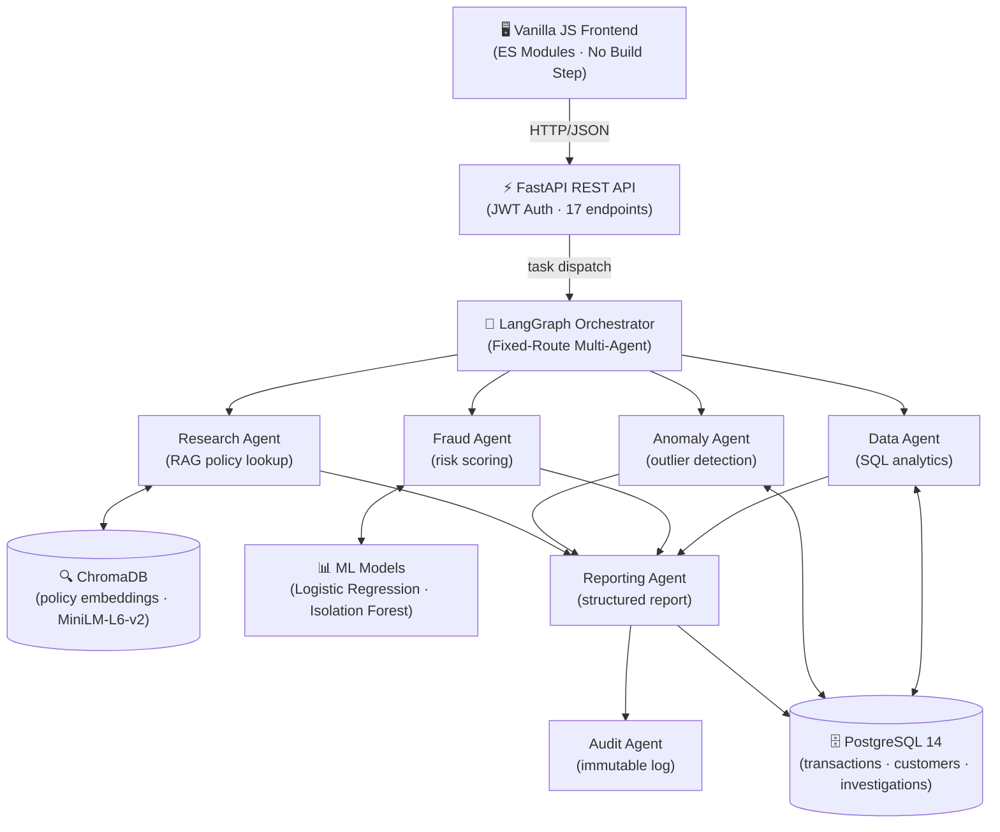
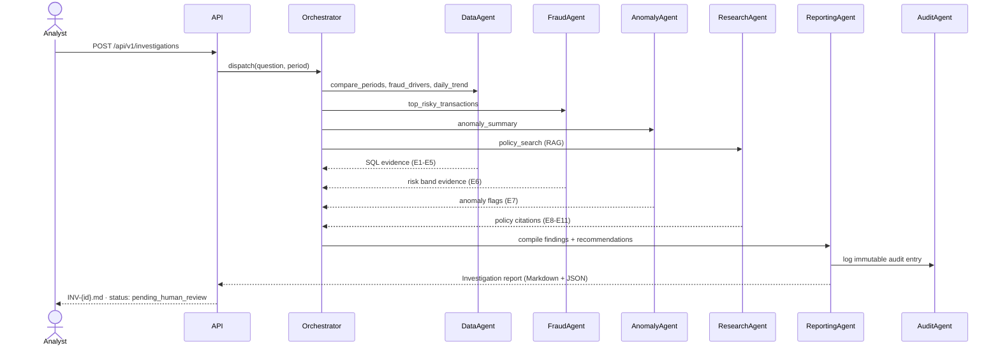

<div align="center">


<br/><br/>

# 🛡️ FinGuard AI

### Autonomous Financial Risk Intelligence Platform

*A production-grade, multi-agent system that detects fraud spikes, investigates root causes, and generates policy-cited investigation reports — with zero automated enforcement.*

<br/>

> **Educational / Research Project** — built on a fully synthetic dataset.  
> No real customer data is processed or stored.

</div>

---

## Table of Contents

- [Overview](#overview)
- [Architecture](#architecture)
- [Multi-Agent Workflow](#multi-agent-workflow)
- [ML Performance](#ml-performance)
- [Live Investigation Example](#live-investigation-example)
- [API Reference](#api-reference)
- [Project Structure](#project-structure)
- [Getting Started](#getting-started)
  - [Prerequisites](#prerequisites)
  - [Local Development](#local-development)
  - [Docker Compose](#docker-compose)
- [Security Controls](#security-controls)
- [Testing](#testing)
- [Known Limitations](#known-limitations)
- [Roadmap](#roadmap)
- [License](#license)

---

## Overview

FinGuard AI answers one question: **"Why has our fraud rate increased?"**

An analyst submits a question. A LangGraph orchestrator dispatches six specialised agents — each with deterministic tool access — to gather SQL evidence, run ML scoring, detect anomalies, retrieve policy documents via RAG, and compile a structured, limitation-aware investigation report. No automated action is ever taken; every finding requires documented human approval.

**Key capabilities:**

| Capability | Implementation |
|---|---|
| Fraud spike detection | Period-vs-baseline KPI comparison via SQL analytics |
| Risk scoring | Logistic Regression trained on synthetic transaction data |
| Anomaly detection | Isolation Forest + per-customer z-score baseline |
| Policy retrieval | ChromaDB + `all-MiniLM-L6-v2` over 5 internal PDFs |
| Investigation reports | Structured Markdown with finding IDs, evidence tables, policy citations |
| Human-in-the-loop | Every recommendation requires explicit human approval |
| REST API | 17 FastAPI endpoints with JWT authentication |
| Frontend | Vanilla JS dashboard (ES modules, no build step) |

---

## Architecture



---

## Multi-Agent Workflow



---

## ML Performance

Models are trained on **synthetic** transaction data. Two classifiers are evaluated; the best is selected automatically.

### Selected Model: Logistic Regression (`fraud_v1.joblib`)

| Split | Period | Rows | Fraud | ROC-AUC | PR-AUC | Top-2% Precision |
|---|---|---|---|---|---|---|
| **Validation** | Sep 24–30 2026 | 7,073 | 54 (0.76%) | 0.7593 | 0.0503 | 6.38% |
| **Test (spike week)** | Oct 1–7 2026 | 7,051 | 450 (6.38%) | **0.9768** | **0.8838** | **99.29%** |

### Model Comparison (Test Set)

| Model | ROC-AUC | PR-AUC | Top-2% Precision |
|---|---|---|---|
| **Logistic Regression** ✅ | 0.9768 | 0.8838 | 0.9929 |
| Random Forest | 0.9312 | 0.3930 | 0.1348 |

> **Note:** The dramatic improvement on the spike week (Oct 1–7) reflects the synthetic dataset's fraud concentration — these metrics do not generalise to real-world fraud detection.

---

## Live Investigation Example

**INV-002** — *"Why has the fraud rate increased?"*

```
Period:   2026-10-01 to 2026-10-07
Baseline: 2026-09-17 to 2026-09-30
```

| Finding | Detail |
|---|---|
| **F1** Overall fraud rate | **6.38%** (450/7051) vs 0.73% baseline → **8.74× baseline** |
| **F2** Top merchant categories | gift_cards 54.71% · electronics 23.4% · jewelry 32.66% |
| **F3** Top countries | BR 78.19% · NG 79.43% · RU 71.34% |
| **F4** Channel | online 15.19% (baseline 0.92%) |
| **F5** Device type | new devices 20.21% (baseline 1.02%) |
| **F6** High-risk transactions | 448 in HIGH band; top: TXN-054972, TXN-054939, TXN-054999 |
| **F7** Anomalies | 463/7051 (6.57%) flagged; top reason: night-time (430) |
| **F8** Policy breach | 8.74× exceeds 5× critical threshold (TMP-002 §3.2) |

**Recommendations** (require human approval):
- Escalate per ESC-003 §2.2 Level 3 Escalation
- Analyst to review 5 highest-scored transactions
- No automated blocking — documented human approval required (ESC-003 §3)

---

## API Reference

Base URL: `http://localhost:8000`  
Authentication: `Authorization: Bearer <JWT>`

| Method | Endpoint | Auth | Description |
|---|---|---|---|
| `GET` | `/api/v1/health` | — | Service health check |
| `POST` | `/api/v1/auth/login` | — | Obtain JWT token |
| `POST` | `/api/v1/auth/register` | — | Create new account |
| `GET` | `/api/v1/transactions` | ✅ | Paginated transaction list |
| `GET` | `/api/v1/risk/summary` | ✅ | Fraud KPIs for a period |
| `GET` | `/api/v1/risk/trend` | ✅ | Daily fraud rate trend |
| `GET` | `/api/v1/risk/drivers` | ✅ | Fraud rate by dimension |
| `GET` | `/api/v1/data/coverage` | ✅ | Dataset date coverage |
| `POST` | `/api/v1/risk/predict` | ✅ | Score a single transaction |
| `POST` | `/api/v1/policies/search` | ✅ | Semantic policy search (RAG) |
| `GET` | `/api/v1/investigations` | ✅ | List all investigations |
| `POST` | `/api/v1/investigations` | ✅ | Launch new investigation |
| `GET` | `/api/v1/investigations/{id}` | ✅ | Get investigation report |
| `POST` | `/api/v1/investigations/{id}/review` | ✅ | Submit human review decision |
| `POST` | `/api/v1/agent/chat` | ✅ | Conversational agent interface |

Interactive docs: `http://localhost:8000/docs`

---

## Project Structure

```
FinGuard-AI/
├── Dockerfile                     # Multi-stage Python image
├── docker-compose.yml             # API + PostgreSQL + ChromaDB services
├── .env.example                   # Environment variable template
├── requirements.txt               # Production dependencies
├── requirements-dev.txt           # Test & dev dependencies
│
├── data/
│   ├── raw/                       # customers.csv · transactions.csv (synthetic)
│   └── chroma/                    # ChromaDB vector store (auto-generated)
│
├── docs/
│   ├── eda/                       # 4 exploratory analysis charts (PNG)
│   ├── reports/                   # INV-001, INV-002 (JSON + Markdown)
│   └── risk_policies/             # 5 internal policy PDFs + generator
│
├── frontend/
│   ├── index.html
│   ├── css/styles.css
│   └── js/
│       ├── app.js                 # Auth, routing, navigation
│       ├── api.js                 # Fetch wrapper + JWT handling
│       ├── ui.js                  # Shared UI utilities
│       ├── charts.js              # Chart.js wrappers
│       ├── dates.js               # Date formatting helpers
│       └── pages/
│           ├── overview.js        # Dashboard KPI page
│           ├── transactions.js    # Transaction explorer
│           ├── investigations.js  # Investigation manager
│           └── assistant.js       # AI chat interface
│
├── models/
│   ├── fraud_v1.joblib            # Trained Logistic Regression
│   └── metrics_fraud_v1.json      # Model evaluation metrics
│
├── src/
│   ├── agents/
│   │   ├── orchestrator.py        # LangGraph state machine
│   │   ├── common.py              # Shared agent utilities
│   │   ├── audit_agent.py         # Immutable audit logging
│   │   ├── data_agent.py          # SQL analytics agent
│   │   ├── fraud_agent.py         # Risk scoring agent
│   │   ├── anomaly_agent.py       # Outlier detection agent
│   │   ├── research_agent.py      # RAG policy retrieval agent
│   │   └── reporting_agent.py     # Report compilation agent
│   ├── analytics/
│   │   ├── tools.py               # 15 analytics tool functions
│   │   ├── anomaly_detection.py   # Isolation Forest pipeline
│   │   └── eda.py                 # Exploratory data analysis
│   ├── api/
│   │   ├── main.py                # FastAPI app + all routes
│   │   ├── schemas.py             # Pydantic request/response models
│   │   ├── security.py            # JWT creation & verification
│   │   └── users.py               # User CRUD operations
│   ├── data/
│   │   ├── ingestion.py           # CSV → PostgreSQL loader
│   │   └── validation.py          # Data quality checks
│   ├── database/
│   │   ├── Schema.sql             # Full DDL with constraints
│   │   ├── connection.py          # SQLAlchemy engine factory
│   │   ├── load_data.py           # Seed script
│   │   └── setup_readonly_user.py # Read-only DB user setup
│   ├── ml/
│   │   ├── train.py               # Model training pipeline
│   │   └── predict.py             # Inference utilities
│   └── rag/
│       ├── embeddings.py          # Embedding model wrapper
│       ├── ingest_documents.py    # PDF → ChromaDB ingestion
│       └── retriever.py           # Semantic retrieval
│
└── tests/
    ├── test_tools.py              # Analytics tool unit tests
    ├── test_rag.py                # RAG pipeline tests
    ├── test_agents.py             # Agent integration tests
    ├── test_api.py                # API endpoint tests
    └── test_frontend.py           # Static asset serving tests
```

---

## Getting Started

### Prerequisites

| Requirement | Version | Notes |
|---|---|---|
| Python | 3.12 or 3.13 | Use `python --version` to verify |
| PostgreSQL | 14+ | Running on port 5432 |
| Git | Any | — |
| Docker Desktop | 24+ | Optional — for Docker Compose setup |
| Ollama | Latest | Optional — for LLM summarisation |

### Local Development

```bash
# 1. Clone the repository
git clone https://github.com/Naveengupta2006/FinGuard-AI.git
cd FinGuard-AI/FinGuard-AI

# 2. Create and activate virtual environment
python -m venv .venv

# Windows (PowerShell)
.\.venv\Scripts\Activate.ps1

# macOS / Linux
source .venv/bin/activate

# 3. Install dependencies
pip install -r requirements.txt
pip install -r requirements-dev.txt   # for testing

# 4. Configure environment
copy .env.example .env
# Edit .env with your PostgreSQL credentials and a secure SECRET_KEY

# 5. Create the database schema
psql -U postgres -c "CREATE DATABASE finguard;"
psql -U postgres -d finguard -f src/database/Schema.sql

# 6. Load synthetic data
python src/database/load_data.py

# 7. Ingest policy documents into ChromaDB
python src/rag/ingest_documents.py

# 8. Create the default admin user
python src/api/create_user.py --username admin --password changeme

# 9. Train the fraud model (optional — pre-trained model is included)
python src/ml/train.py

# 10. Start the API server
uvicorn src.api.main:app --reload --port 8000

# 11. Open the frontend
# Navigate to http://localhost:8000 in your browser
```

### Docker Compose

> **Requires Docker Desktop** to be installed and running.

```bash
# Copy and configure environment
copy .env.example .env
# Edit .env as needed

# Build and start all services (API + PostgreSQL + ChromaDB)
docker compose up --build

# Services:
#   API       → http://localhost:8000
#   Docs      → http://localhost:8000/docs
#   PostgreSQL → localhost:5432
```

---

## Security Controls

| Control | Implementation |
|---|---|
| Authentication | JWT (HS256) with configurable expiry via `SECRET_KEY` |
| Password hashing | bcrypt / scrypt via `passlib` |
| Read-only DB access | Separate `finguard_readonly` PostgreSQL role for analytics queries |
| Secrets management | `.env` excluded from git; `.env.example` for reference |
| Content Security Policy | CSP headers on all API responses; no inline scripts in frontend |
| No automated enforcement | All agent recommendations require explicit human approval before action |
| Audit logging | Immutable `audit_log` table — every agent action is recorded |

> ⚠️ **Never commit `.env` to version control.** Rotate all credentials if they were ever pushed.

---

## Testing

```bash
# Activate venv first
.\.venv\Scripts\Activate.ps1

# Run all tests
python -m pytest tests/ -v

# Run with coverage
python -m pytest tests/ --cov=src --cov-report=term-missing

# Run specific test file
python -m pytest tests/test_tools.py -v
```

**Test suite: 65 tests across 5 files**

| File | Coverage |
|---|---|
| `test_tools.py` | Analytics tools (SQL, KPI, trend functions) |
| `test_rag.py` | RAG ingestion and semantic retrieval |
| `test_agents.py` | Agent orchestration and tool dispatch |
| `test_api.py` | All 17 API endpoints (auth, data, risk, investigations) |
| `test_frontend.py` | Static asset serving and CSP compliance |

---

## Known Limitations

| Area | Limitation |
|---|---|
| **Dataset** | Fully synthetic — model metrics do not transfer to real-world fraud |
| **LLM** | Ollama (llama3.2:3b) is optional; without it, reports are template-based |
| **Risk score** | Logistic Regression output is a ranking score, not a calibrated probability |
| **Anomaly detection** | Isolation Forest flags statistical outliers — not confirmed fraud |
| **Causality** | All findings are associational; the system cannot determine causation |
| **Scale** | No async workers or message queue — long investigations block the request |
| **Multi-tenancy** | Single-tenant design; no row-level security between organisations |
| **Docker** | Compose file is production-ready but requires Docker Desktop |

---

## Roadmap

- [x] Multi-agent LangGraph orchestration
- [x] FastAPI REST API with JWT auth
- [x] Logistic Regression + Isolation Forest ML pipeline
- [x] RAG policy retrieval (ChromaDB + MiniLM)
- [x] Vanilla JS dashboard (5 pages)
- [x] Create Account / Register flow
- [x] Dockerfile + Docker Compose
- [x] Audit logging
- [ ] Async investigation workers (Celery / ARQ)
- [ ] WebSocket progress updates during investigation
- [ ] Calibrated probability output (Platt scaling)
- [ ] Multi-tenancy with row-level security
- [ ] CI/CD pipeline (GitHub Actions)
- [ ] Grafana + Prometheus observability stack
- [ ] Ollama streaming responses in chat interface

---

## License

This project is licensed under the **MIT License** — see [LICENSE](LICENSE) for details.

---

<div align="center">

Built for learning. No real financial data was used or harmed.  
**FinGuard AI** · Educational Financial Risk Intelligence Platform

</div>
