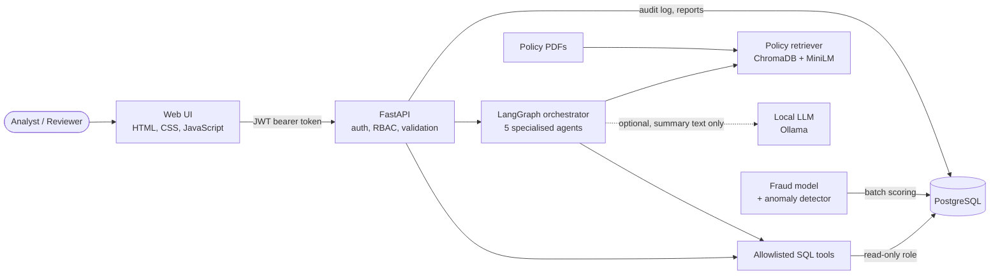
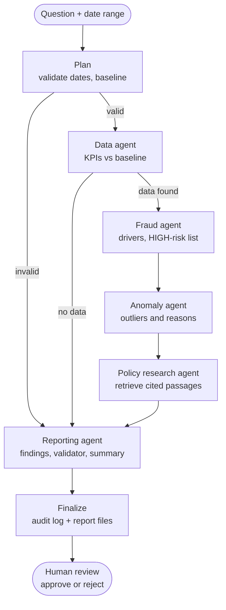

# 🛡️ FinGuard AI

**Autonomous Financial Risk Intelligence Platform**: a multi-agent, evidence-grounded fraud investigation system with human-in-the-loop review.


> **Educational decision-support system.** It runs on a **synthetic dataset** and fictional policy documents. It never blocks a transaction, changes an account, or approves/denies credit. Every consequential action requires documented human approval. Results shown here describe the synthetic data and must not be read as real-world performance.

---

## Table of contents

1. [Overview](#1-overview)
2. [Key results](#2-key-results)
3. [Demo scenario](#3-demo-scenario)
4. [Architecture](#4-architecture)
5. [Multi-agent workflow](#5-multi-agent-workflow)
6. [Data and database](#6-data-and-database)
7. [Machine learning](#7-machine-learning)
8. [Anomaly detection](#8-anomaly-detection)
9. [RAG: policy knowledge base](#9-rag-policy-knowledge-base)
10. [REST API](#10-rest-api)
11. [Web UI](#11-web-ui)
12. [Security and privacy](#12-security-and-privacy)
13. [Testing](#13-testing)
14. [Getting started](#14-getting-started)
15. [Project structure](#15-project-structure)
16. [Limitations](#16-limitations)
17. [Roadmap](#17-roadmap)
18. [Troubleshooting](#18-troubleshooting)
19. [License and author](#19-license-and-author)

---

## 1. Overview

### The problem

A bank or fintech processes thousands of transactions a day. Fraud analysts need to:

- find suspicious transactions and unusual behaviour,
- explain **why** a fraud rate moved, not just that it did,
- follow internal policy (escalation thresholds, evidence standards),
- write investigation reports, and keep an audit trail.

A classic fraud model returns a score. It does not investigate.

### The solution

FinGuard AI answers questions such as:

> *"Why has the fraud rate increased this week? Identify high-risk transactions and prepare an investigation report."*

It combines **SQL analytics**, a **fraud model**, an **anomaly detector**, and **policy retrieval (RAG)**, coordinated by a **LangGraph** workflow of specialised agents. The output is a structured report in which **every finding links to evidence**, every policy statement carries a **citation** (document, section, page), limitations are stated, and the result waits for **human approval**.

### What makes it different

| Principle | How it is implemented |
|---|---|
| **Evidence or silence** | Findings are generated from tool results by templates, not by an LLM. No evidence means an empty `findings` list, never a guess. |
| **LLM where it helps, never where it can mislead** | The optional local LLM only rewrites the summary text. Every number it writes is checked against the findings; a mismatch rejects the summary. |
| **Least privilege** | Each agent can call only its own tools. Tools run as a **read-only** database user with fixed, parameterised queries. There is no arbitrary SQL. |
| **Human in the loop** | Reports start as `pending_human_review`. Approve or reject is recorded once, with the reviewer, in an audit log. |
| **Reproducible** | One command rebuilds the dataset, database, model, scores, anomalies and policy index. |

---

## 2. Key results

All numbers below come from the **synthetic dataset** (60,000 transactions, 9 Aug to 7 Oct 2026) and the included test run.

| Area | Result |
|---|---|
| **Fraud spike found** | Fraud rate **6.38%** in 1-7 Oct vs **0.73%** in the 14 days before: **8.74x** |
| **Drivers identified** | gift_cards 54.7%, jewelry 32.7%, electronics 23.4%; countries BR, NG, RU (71-79%); online channel and new devices |
| **Policy check** | 8.74x exceeds the 5x critical threshold in `TMP-002` section 3.2; escalation guidance cited from `ESC-003` section 2.2 |
| **Investigation report** | 8 grounded findings, 11 evidence items, 4 policy retrievals, 6 agent runs, all audit-logged |
| **Fraud model (spike week)** | Logistic Regression: PR-AUC 0.88, ROC-AUC 0.98. Top 2% of alerts: precision 0.99 |
| **Fraud model (normal week)** | PR-AUC **0.05** on a 0.76% base rate. The model is weak when fraud is mostly noise (see [Limitations](#16-limitations)) |
| **Anomaly detector** | 0.81% of transactions flagged in a normal week vs 6.57% in the spike week |
| **Quality gates** | 65 pytest tests, plus an optional 12-step browser-simulation smoke test per role |

---

## 3. Demo scenario

**Question:** *"Why has the fraud rate increased this week?"* for 2026-10-01 to 2026-10-07.

The system compares the week with the 14 days before it, ranks drivers, lists the highest-risk transactions, checks anomalies, retrieves policy passages, and produces a report. Excerpt (real output, see [`docs/sample_report.md`](docs/sample_report.md)):

> **F1** Fraud rate was 6.38% (450 of 7051 transactions) in 2026-10-01 to 2026-10-07, versus 0.73% (103 of 14159) in the baseline 2026-09-17 to 2026-09-30, which is 8.74 times the baseline rate. *[E1]*
>
> **F2** Elevated fraud is concentrated in merchant_category: 'gift_cards' 54.71% (209 of 382 transactions; baseline 1.23%); 'electronics' 23.4% (139 of 594; baseline 1.49%); 'jewelry' 32.66% (65 of 199; baseline 2.03%). This is an association, not proof of cause. *[E2]*
>
> **F8** The fraud-rate multiple (8.74x) exceeds the 5x threshold stated in TMP-002, Transaction Monitoring Policy, section 3.2 Critical Threshold, p.2. *[E1, E8]*
>
> **Recommendation (requires human approval):** Escalate for human review as described in ESC-003, Risk Escalation Guidelines, section 2.2 Level 3 Escalation, p.1.

Charts produced by the web UI for this scenario:

| Daily fraud rate (selected week shaded) | Fraud rate by merchant category |
|---|---|
|  |  |

*Right chart: blue = selected week, grey = 14-day baseline.*

<!-- Add your own screenshots after running locally, then reference them here:
     docs/images/ui-overview.png, docs/images/ui-investigation.png, docs/images/ui-review.png -->

---

## 4. Architecture



### Technology stack

| Layer | Technology | Responsibility |
|---|---|---|
| Data | PostgreSQL 14+, SQLAlchemy, psycopg 3 | Transactions, scores, anomalies, investigations, audit logs |
| Analytics | pandas, SQL | KPIs, trends, driver analysis |
| ML | scikit-learn | Logistic Regression and Random Forest, Isolation Forest |
| Agents | LangGraph | Orchestration with fixed routing |
| RAG | PyMuPDF, Sentence Transformers (`all-MiniLM-L6-v2`), ChromaDB | Cited policy retrieval |
| LLM (optional) | Ollama, `llama3.2:3b` | Summary wording only |
| Backend | FastAPI, Pydantic, PyJWT | REST API, authentication, validation |
| Frontend | Vanilla JavaScript (ES modules), SVG charts | Single-page app served by FastAPI, no build step |
| Quality | pytest, FastAPI TestClient, jsdom | Unit, integration, security and UI tests |

---

## 5. Multi-agent workflow

The workflow is a LangGraph state graph with **fixed routing**. Agents do not decide what to run next; the orchestrator does.



### Agent permissions (least privilege)

| Agent | Allowed tools | Output |
|---|---|---|
| Orchestrator | none (routing and state only) | Plan, baseline period |
| Data Intelligence | `compare_periods` | KPIs for the period and the baseline |
| Fraud Risk | `fraud_drivers`, `top_risky_transactions` | Driver groups, HIGH-risk transactions |
| Anomaly | `anomaly_summary` | Anomaly counts and reasons |
| Policy Research | `policy_search` (RAG) | Cited policy passages |
| Investigation and Reporting | none (reads collected evidence) | Findings, recommendations, report |

A call outside this matrix raises `PermissionError` (tested). If one agent fails, the run continues and the report states what evidence is missing.

### How a report is built

1. **Evidence:** every tool call becomes an evidence item (`E1`...`E11`) with its source, tool and input hash. Transaction data and policy documents are kept as separate sources.
2. **Findings:** generated from tool output by templates (not an LLM) and linked to evidence IDs.
3. **Validation:** a finding without valid evidence is removed and noted in the limitations. If no data exists for the period, `findings` is empty.
4. **Summary:** a template summary by default. With `--llm`, a local model writes it, and the text is **rejected** if it contains any number not present in the findings (falls back to the template and records why).
5. **Recommendations:** derived from retrieved policy text; always end with the human-approval requirement.
6. **Audit:** the investigation, each agent run, each tool call and the review decision are stored in PostgreSQL.

### Report contract

```json
{
  "status": "pending_human_review",
  "investigation_id": "INV-001",
  "question": "...",
  "period": {"start": "2026-10-01", "end": "2026-10-07", "baseline_start": "...", "baseline_end": "..."},
  "summary": "...", "summary_source": "template",
  "findings": [{"id": "F1", "statement": "...", "evidence_ids": ["E1"]}],
  "recommendations": [{"text": "...", "evidence_ids": ["E9", "E1"]}],
  "evidence": [{"id": "E1", "source": "transaction_data", "tool": "compare_periods", "input_hash": "...", "summary": "...", "data": {}}],
  "policy_references": [{"citation": "ESC-003, ... section 2.2 ..., p.1", "excerpt": "..."}],
  "limitations": ["..."],
  "human_review": {"required": true, "status": "pending", "reviewer": null}
}
```

Statuses: `pending_human_review`, `approved`, `rejected`, `no_evidence`.

---

## 6. Data and database

### Synthetic dataset

Generated by [`scripts/generate_finguard_data.py`](scripts/generate_finguard_data.py) with a fixed seed (identical output on every run).

| | |
|---|---|
| Transactions | 60,000 over 9 Aug to 7 Oct 2026 |
| Customers | 2,000, with pseudonymised IDs (`CUST-00001`) |
| Overall fraud rate | 1.36% (813 cases) |
| Built-in scenario | A coordinated pattern in 1-7 Oct: new device, online channel, night-time, gift cards / electronics / jewelry, countries NG / RU / BR, amounts 2.5-6x typical |

`transactions` columns: `transaction_id, customer_id, timestamp, amount, merchant, merchant_category, country, home_country, is_international, channel, device_type, is_fraud`.

Because the dataset is synthetic, the spike is deliberately conspicuous. Treat the model and anomaly numbers as a demonstration of the pipeline, not as a benchmark. Public datasets such as Kaggle's Credit Card Fraud or PaySim are natural next steps (see [Roadmap](#17-roadmap)).

### Database design (PostgreSQL)

| Table | Purpose |
|---|---|
| `customers`, `transactions` | Core data (pseudonymised customer IDs) |
| `risk_predictions` | Model scores and risk bands per transaction |
| `anomaly_events` | Flagged transactions with human-readable reasons |
| `investigations` | Investigation status and summary |
| `agent_runs`, `agent_tool_calls` | Execution trace per agent and tool (input hashes, status, timing) |
| `audit_logs` | Who did what and when (logins, investigations, reviews) |
| `risk_policies` | Reserved for policy document metadata |
| `app_users` | API users (created by the API, outside `schema.sql`) |

Two database roles are used: an admin role (loading, training, API writes) and a **read-only role** (`SELECT` on four tables only) for everything the agents run.

---

## 7. Machine learning

### Methodology

- **Time-based split** (no random split, to avoid look-ahead leakage):

| Set | Dates | Fraud rate |
|---|---|---|
| Train | 9 Aug - 23 Sep | 0.67% |
| Validation | 24 - 30 Sep | 0.76% |
| Test (spike week) | 1 - 7 Oct | 6.38% |

- **Features:** log amount, hour, night flag, international flag, merchant category, country, channel, device type.
- **Models:** Logistic Regression (baseline) and Random Forest, both with class weights. Model selection uses **validation** PR-AUC.
- **Metrics:** precision, recall, F1, PR-AUC, ROC-AUC, confusion matrix, plus **precision/recall in the top 2% of alerts** (an analyst-capacity view).

### Results

| Model | Period | PR-AUC | ROC-AUC | Recall @0.5 | Precision @0.5 | Top-2% precision |
|---|---|---|---|---|---|---|
| Logistic Regression | Validation | 0.05 | 0.76 | 0.61 | 0.02 | 0.06 |
| Logistic Regression | Test | 0.88 | 0.98 | 0.98 | 0.21 | 0.99 |
| Random Forest | Validation | 0.02 | 0.72 | 0.04 | 0.04 | 0.04 |
| Random Forest | Test | 0.39 | 0.93 | 0.002 | 0.03 | 0.13 |

**How to read this honestly**

- In a normal week, fraud labels in the synthetic data are mostly noise, so ranking power is low (validation PR-AUC 0.05 against a 0.76% base rate). Hyper-parameter tuning would not help.
- In the spike week, the pattern is new relative to training (distribution drift). Logistic Regression generalises; Random Forest ranks reasonably (ROC-AUC 0.93) but its probabilities are miscalibrated at the 0.5 threshold, so it flags almost nothing. This is why the system works with **alert budgets and risk bands**, not a single cut-off.
- `risk_score` is a **ranking score, not a calibrated probability** (class weights inflate it). The UI and API say so.

### Risk bands (chosen from validation/test data)

| Band | Score | Share of scored transactions | Fraud rate in band |
|---|---|---|---|
| HIGH | >= 0.90 | 3.9% | 67.6% |
| MEDIUM | 0.70 - 0.90 | 8.9% | 5.9% |
| LOW | < 0.70 | 87.2% | 0.5% |

Scores are written only for **out-of-sample** transactions (from 24 Sep). Training rows are not scored, because in-sample scores are optimistic.

---

## 8. Anomaly detection

The supervised model finds patterns it has seen. The anomaly detector looks for what is **unusual**, without using labels.

- **Isolation Forest** on transaction features plus a **per-customer spending baseline** (z-score of log amount).
- Baseline and threshold come only from data **before 24 Sep** (no leakage); the threshold is the baseline's 99th percentile.
- Each anomaly gets **evidence-based reasons**, for example: *"rare country 'RU' (0.6% of baseline txns); rare category 'jewelry' (2.1%); night-time (00:00); amount 8.7x customer's typical"*.

| Period | Transactions | Flagged | Rate |
|---|---|---|---|
| 24 - 30 Sep (normal) | 7,073 | 57 | 0.81% |
| 1 - 7 Oct (spike) | 7,051 | 463 | 6.57% |

The flagged set contains 77.5% confirmed fraud and covers 80% of all fraud in the scored period. Labels are used for evaluation only. As with the model, the spike is conspicuous by construction.

---

## 9. RAG: policy knowledge base

Five **fictional** policy documents in [`docs/risk_policies/`](docs/risk_policies):

| Document | Content |
|---|---|
| `FIN-SOP-001` Fraud Investigation SOP | Triage deadlines, minimum evidence, reporting limitations |
| `TMP-002` Transaction Monitoring Policy | Monitoring rules, weekly fraud-rate thresholds (2x warning, 5x critical) |
| `ESC-003` Risk Escalation Guidelines | Escalation levels, human approval requirements |
| `MDL-004` Model Documentation (fraud_v1) | Model purpose, metrics, limitations |
| `CRD-005` Credit Risk Definitions | PD, LGD, EAD, default |

**Pipeline:** PyMuPDF extraction -> section-aware chunking (39 chunks, each with document, section and page) -> local embeddings (`all-MiniLM-L6-v2`) -> ChromaDB (cosine) -> retrieval with a similarity floor (`MIN_SCORE = 0.25`).

**Safeguards**

- Every answer carries a citation: `ESC-003, Risk Escalation Guidelines, section 2.2 Level 3 Escalation, p.1`.
- If nothing is similar enough, the result is **empty** with a limitation, never an invented policy answer (tested with an off-topic query).
- Retrieved text is **untrusted data**: it is wrapped as reference data, and passages containing instruction-like text ("ignore previous instructions", ...) are dropped.
- Policy text and transaction data are separate evidence sources.

---

## 10. REST API

Interactive docs: `http://127.0.0.1:8000/docs`. All endpoints except `health` and `login` require `Authorization: Bearer <token>`.

| Method | Endpoint | Role | Purpose |
|---|---|---|---|
| GET | `/api/v1/health` | public | Database, policy index, model status |
| POST | `/api/v1/auth/login` | public | Returns a JWT |
| GET | `/api/v1/data/coverage` | viewer | Data date range |
| GET | `/api/v1/transactions` | viewer | Filtered, paginated transaction search |
| GET | `/api/v1/risk/summary` | viewer | KPIs, risk bands, anomalies |
| GET | `/api/v1/risk/trend` | viewer | Daily fraud rate |
| GET | `/api/v1/risk/drivers` | viewer | Fraud rate by dimension vs baseline |
| POST | `/api/v1/policies/search` | viewer | Cited policy search |
| GET | `/api/v1/investigations` | viewer | List investigations |
| GET | `/api/v1/investigations/{id}` | viewer | Full report |
| POST | `/api/v1/investigations` | analyst | Run the agent workflow |
| POST | `/api/v1/investigations/{id}/review` | analyst | Approve or reject (once) |
| POST | `/api/v1/agent/chat` | analyst | With `date_range`: investigation. Without: policy Q&A |
| POST | `/api/v1/risk/predict` | analyst | Score one transaction (ranking score) |

Roles are hierarchical: `viewer` < `analyst` < `admin`.

### Example

```bash
TOKEN=$(curl -s -X POST http://127.0.0.1:8000/api/v1/auth/login \
  -H "Content-Type: application/json" \
  -d '{"username":"analyst1","password":"<your password>"}' | python -c "import sys,json; print(json.load(sys.stdin)['access_token'])")

curl -s -X POST http://127.0.0.1:8000/api/v1/investigations \
  -H "Authorization: Bearer $TOKEN" -H "Content-Type: application/json" \
  -d '{"question":"Why did fraud increase this week?","date_range":{"start":"2026-10-01","end":"2026-10-07"}}'
```

On Windows PowerShell, the Swagger UI at `/docs` (Authorize button) is the simplest way to try the API.

Input is validated strictly: ISO dates, ranges of at most 120 days, result limits (at most 100 rows), and enumerated or pattern-checked filters.

---

## 11. Web UI

A single-page app in [`frontend/`](frontend), served by FastAPI at `/`. Plain HTML, CSS and ES modules: **no build step, no Node.js, no external CDN.** Charts are hand-built SVG. Dark mode follows the system setting.

| Page | What it provides |
|---|---|
| **Login** | Username and password; session ends when the tab closes |
| **Overview** | KPI cards with change vs the previous period, risk bands, daily trend (selected period shaded), driver breakdown by category / country / channel / device, anomaly summary |
| **Transactions** | Filters (category, country, risk band, min amount), pagination, risk scores |
| **Investigations** | List, run a new investigation (analysts), full report with evidence and limitations, **approve/reject** with a note |
| **Policy assistant** | Cited policy answers; analysts can switch to a data investigation for the selected period |

Role-based UI: viewers do not see write controls. This is a convenience only; the server enforces roles.

---

## 12. Security and privacy

| Threat | Control | Verified by |
|---|---|---|
| Arbitrary SQL / SQL injection | Fixed queries, column names from an allowlist, values as bind parameters | `test_tools`, `test_api` (injection strings rejected) |
| Agent modifies or reads sensitive data | Read-only DB role with `SELECT` on four tables; `audit_logs` is not readable by it | `test_tools` (DELETE and audit read fail) |
| Agent overreach | Per-agent tool permissions | `test_agents` |
| Password theft | scrypt hashing (N=2^14, r=8, p=1) with per-user salt | `test_api` |
| Forged or expired tokens | HS256, pinned algorithm, required `exp`/`iss`, secret >= 32 characters (startup fails otherwise) | `test_api` (wrong secret, expired, `alg: none`) |
| Privilege escalation | Role is in the signed token; server-side RBAC on every route | `test_api` |
| Brute force and user enumeration | 5 failed logins per 10 minutes per user and IP (429); identical error and timing for unknown users | `test_api` |
| Path traversal | `INV-\d{3,6}` ID validation; static files confined to `frontend/` | `test_api`, `test_frontend` |
| XSS | No `innerHTML` anywhere (a test fails if it appears), strict CSP without `unsafe-inline`, no external scripts | `test_frontend`, browser-simulation test |
| Clickjacking and sniffing | `X-Frame-Options: DENY`, `frame-ancestors 'none'`, `nosniff`, `no-store` on API responses | `test_frontend` |
| Prompt injection via documents | Retrieved text treated as data; instruction-like passages dropped | `test_rag` |
| LLM inventing numbers | Output verified against findings; rejected on mismatch | `test_agents` |
| Unreviewed consequential action | No endpoint blocks or modifies anything; status changes only through a recorded human review (decision is final: 409 on repeat) | `test_api` |
| Secrets in git | `.env` is git-ignored; `.env.example` has placeholders | `.gitignore` |

**Privacy:** customer identifiers are pseudonymised; no raw personal data exists in the dataset or in LLM prompts (the optional LLM receives only the verified finding statements).

---

## 13. Testing

```bash
python -m pytest tests -q
```

| File | Tests | Covers |
|---|---|---|
| `tests/test_tools.py` | 10 | Tool allowlist, parameter validation, injection, read-only role |
| `tests/test_rag.py` | 10 | PDF parsing, citations, retrieval, injection filter, no-match behaviour |
| `tests/test_agents.py` | 12 | Permissions, grounded reports, empty-evidence cases, LLM guardrail, audit rows |
| `tests/test_api.py` | 25 | Auth, token attacks, roles, validation, data endpoints, review flow |
| `tests/test_frontend.py` | 8 | Static serving, security headers, no inline script, no dangerous APIs |

Integration tests need the pipeline to have run (database, scores, anomalies, RAG index). The first run downloads the embedding model (about 90 MB).

**Optional browser-simulation test** (needs Node.js 20+): runs the real frontend code in jsdom against a live server, as an analyst and as a viewer (login, charts, filters, investigation, review, assistant, XSS attempt, session expiry, logout).

```bash
npm install --no-save jsdom
FG_BASE=http://127.0.0.1:8000 FG_USER=<user> FG_PASS=<password> FG_ROLE=analyst node tests/frontend_smoke.test.mjs
```

This is a DOM simulation, not a real browser. Real-browser end-to-end tests are on the roadmap.

---

## 14. Getting started

### Prerequisites

- Python 3.11 or newer (developed on 3.12 and 3.13)
- PostgreSQL 14 or newer
- Optional: [Ollama](https://ollama.com) for the local LLM summary, Node.js 20+ for the UI smoke test

### Quick start (Windows PowerShell)

```powershell
git clone https://github.com/<your-username>/FinGuard-AI.git
cd FinGuard-AI

py -3.12 -m venv .venv
.venv\Scripts\Activate.ps1
pip install -r requirements-dev.txt
```

macOS / Linux: `python3 -m venv .venv && source .venv/bin/activate`, then the same `pip install`.

**1. Create the database** (pgAdmin or `psql`):

```sql
CREATE DATABASE finguard;
```

**2. Configure secrets.** Copy `.env.example` to `.env` and fill it in:

```powershell
copy .env.example .env
python -c "import secrets; print(secrets.token_urlsafe(48))"   # paste the output as JWT_SECRET
```

**3. Build everything with one command:**

```powershell
python scripts/run_pipeline.py
```

This generates the dataset, loads PostgreSQL, creates the read-only user, trains and evaluates the models, scores transactions, detects anomalies and builds the policy index (about one minute; the first run downloads the embedding model).

**4. Create a user and start the app:**

```powershell
python src/api/create_user.py analyst1 --role analyst
uvicorn main:app --app-dir src/api
```

Open **http://127.0.0.1:8000**, log in, and keep the default period (1-7 Oct) to see the spike. Interactive API docs are at `/docs`.

**5. Run the tests:**

```powershell
python -m pytest tests -q
```

### Run with Docker Compose

To spin up the entire platform (API + web UI + PostgreSQL) in containers:

```powershell
copy .env.example .env    # Fill in DB_PASSWORD and JWT_SECRET
docker compose up --build
```

The app will be available at **http://127.0.0.1:8000** and PostgreSQL is isolated inside the Docker network.

### Command-line investigation (no UI)

```powershell
python src/agents/orchestrator.py                 # prints the report, saves docs/reports/INV-00X.json and .md
python src/agents/orchestrator.py --no-persist    # dry run: nothing written to the database
```

### Optional: local LLM summary

```powershell
ollama pull llama3.2:3b
python src/agents/orchestrator.py --llm --no-persist
```

The summary header shows `(llm)` when the model's text passed number verification, and `(template)` with the reason in the limitations when it did not. Small models often round numbers, so rejections are expected and are the safety check working.

### Configuration (`.env`)

| Variable | Purpose |
|---|---|
| `DB_HOST`, `DB_PORT`, `DB_NAME` | PostgreSQL connection (default `127.0.0.1`, `5432`, `finguard`) |
| `DB_USER`, `DB_PASSWORD` | Admin role: data loading, training, API writes |
| `DB_READONLY_USER`, `DB_READONLY_PASSWORD` | Read-only role used by agent tools (use a different password) |
| `JWT_SECRET` | Token signing key, 32+ random characters. The server refuses to start without it |

`FINGUARD_EMBEDDER=hash` is a test-only switch that replaces the embedding model with an offline stand-in; do not use it for real retrieval.

---

## 15. Project structure

```
FinGuard-AI/
├── frontend/                    # single-page app (served at /)
│   ├── index.html
│   ├── css/styles.css
│   └── js/  app.js  api.js  ui.js  charts.js  dates.js
│            pages/  overview.js  transactions.js  investigations.js  assistant.js
├── src/
│   ├── api/         main.py  security.py  users.py  schemas.py  create_user.py
│   ├── agents/      orchestrator.py  common.py  audit.py
│   │                data_agent.py  fraud_agent.py  anomaly_agent.py
│   │                research_agent.py  reporting_agent.py
│   ├── analytics/   tools.py  anomaly_detection.py  eda.py
│   ├── data/        ingestion.py  validation.py
│   ├── database/    schema.sql  connection.py  load_data.py  setup_readonly_user.py
│   ├── ml/          train.py  predict.py
│   └── rag/         embeddings.py  ingest_documents.py  retriever.py
├── scripts/         generate_finguard_data.py  run_pipeline.py
├── tests/           test_tools.py  test_rag.py  test_agents.py  test_api.py
│                    test_frontend.py  frontend_smoke.test.mjs
├── docs/            risk_policies/ (5 PDFs + generator)  images/  sample_report.md
├── data/ models/    # generated by run_pipeline.py (git-ignored)
├── Dockerfile  docker-compose.yml  .dockerignore  .env.example
├── requirements.txt  requirements-dev.txt  LICENSE  README.md
```

---

## 16. Limitations

Stated plainly, because a decision-support system should know its limits.

- **Synthetic data.** The dataset and the five policy documents are fictional. The fraud spike is conspicuous by construction, so detection quality here says nothing about real portfolios.
- **Weak in normal conditions.** Validation PR-AUC is 0.05; normal-period fraud in the synthetic data is mostly noise.
- **Drift sensitivity.** The Random Forest's probabilities are miscalibrated on the unseen spike pattern. Risk scores are rankings, not probabilities.
- **Policy parsing is regex-based.** Thresholds such as "5 times the baseline" are read from retrieved text. A changed wording yields a stated limitation rather than a wrong answer; production would use structured policy rules.
- **Credit-risk module not built.** Only a definitions document exists; no default model.
- **No transaction upload endpoint.** Data is loaded by the pipeline.
- **API write path uses admin DB credentials.** Agent tools use the read-only role, but the API itself should get a dedicated limited role in production.
- **Session design.** Tokens cannot be revoked before they expire (60 minutes); login throttling is in memory and per process; investigations run synchronously under a lock.
- **Small local LLM.** `llama3.2:3b` often rounds numbers; the guardrail then falls back to the template summary.
- **UI tested by simulation.** The frontend is verified in jsdom and server-side tests, not in real browsers.
- **Local deployment only.** No Docker image or CI pipeline yet, and no TLS termination.

---

## 17. Roadmap

- [x] Docker image and `docker compose` (API + PostgreSQL)
- [ ] GitHub Actions: lint, tests, dependency audit
- [ ] Dedicated least-privilege DB role for the API; token refresh and revocation
- [ ] `POST /transactions/upload` with schema validation, pseudonymisation and admin-only access
- [ ] Credit-risk module (Home Credit style default model) as a second agent domain
- [ ] Evaluate on public datasets (Credit Card Fraud, PaySim) alongside the synthetic scenario
- [ ] Structured policy rules instead of regex over retrieved text
- [ ] Background jobs for long investigations; model drift monitoring
- [ ] Real-browser end-to-end tests (Playwright)

---

## 18. Troubleshooting

| Symptom | Likely cause and fix |
|---|---|
| `No module named ...` or `pytest` not found | Virtual environment not active. Run `.venv\Scripts\Activate.ps1` in the project root (prompt shows `(.venv)`) |
| `can't open file '...\src\...'` | Terminal is in the wrong folder (e.g. a nested `FinGuard-AI\FinGuard-AI`). `cd` to the folder that contains `src\` |
| `Missing in .env: [...]` | A variable is missing. The message lists which one and the path it looked at |
| `JWT_SECRET must be set` | Add a 32+ character secret to `.env` |
| Tests fail with permission errors on tables | `load_data.py` recreates tables and drops grants. Re-run `python src/database/setup_readonly_user.py` (or the whole `run_pipeline.py`) |
| `ollama` not recognised | Ollama is installed but not on PATH. Restart VS Code or the PC, or add `%LOCALAPPDATA%\Programs\Ollama` to your user PATH |
| Page has no styling or is blank | Check `frontend/` has all 11 files in the right subfolders, then hard-refresh with `Ctrl + F5` |
| Policy results missing from a report | The policy index is empty. Run `python src/rag/ingest_documents.py` |

---

## 19. License and author

Released under the [MIT License](LICENSE).

Built by **[Your Name]** as a portfolio project on agentic AI for financial risk analytics.
[GitHub](https://github.com/<your-username>) · [LinkedIn](https://www.linkedin.com/in/<your-profile>)

*This project is an educational demonstration. It is not financial advice and is not intended for production banking decisions.*

